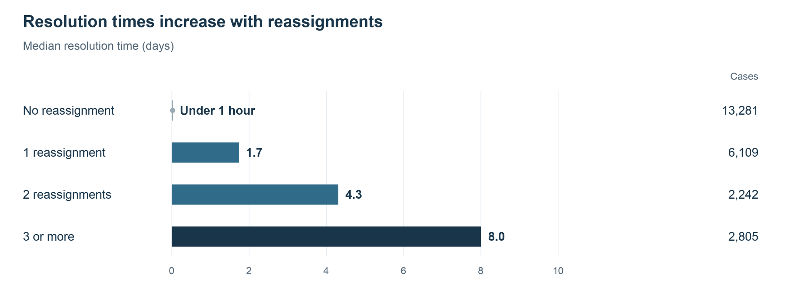
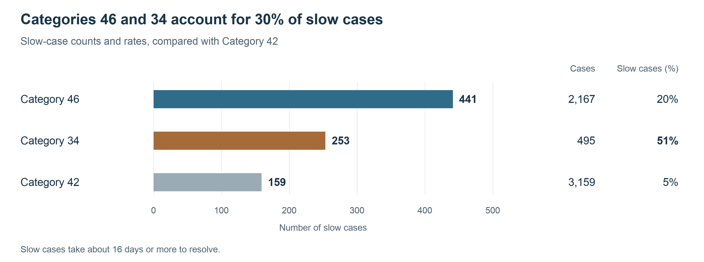
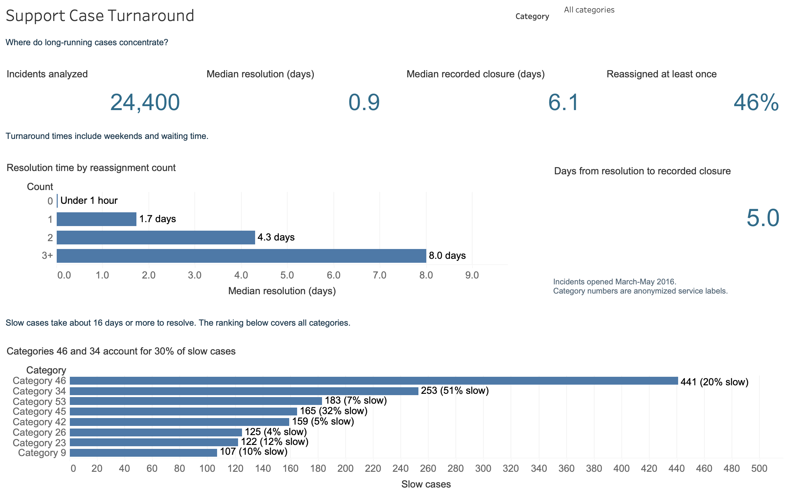

# Support Case Turnaround

**Which support cases account for long resolution times, and where should service managers focus attention?**

## Project overview

This project examines **24,400 IT support incidents** using anonymized records from the UCI Machine Learning Repository. The data comes from ServiceNow, a system that tracks support requests, and captures each case’s status changes, assignments, and completion dates. The analysis uses Excel, Power Query and Tableau to examine resolution times, repeated reassignments, and the categories with the most slow cases.

A single turnaround figure can hide long-running cases and the time between resolution and recorded closure. The findings help service managers choose delays to investigate, decide which turnaround measures to report, and identify reassignment patterns that need closer attention.

[View the dashboard](images/tableau_dashboard.png) · [Download the Tableau workbook](Service_Operations.twbx) · [Open the Excel analysis](Service_Operations.xlsx) · [Read the one-page report](Service_Operations_Report.pdf) · [View the Power Query code](analysis/power-query)

| Measure | Result |
| --- | ---: |
| Median time to resolution | 0.9 days |
| Median time to recorded closure | 6.1 days |
| Cases reassigned at least once | 46% |

Turnaround times include weekends and waiting time.

## What the results show

### Recorded closure typically follows resolution by five days

Half of the cases were resolved in less than a day, but the slowest 10% took **about 16 days or more**.

The gap between resolution and closure was typically **five days**. Using recorded closure to measure turnaround includes those extra days, even though the incident has already been marked as resolved. The data does not show what happens during that gap.

### Repeated reassignments coincide with longer waits

Median resolution time rose from **less than an hour with no reassignment** to **eight days with three or more**. Cases with one reassignment had a median resolution time of roughly 1.7 days; those with two took 4.3 days.

In the three largest groups of cases sharing the same category and priority, those with three or more reassignments still took a median **six to nine days longer** to resolve than those with none. Priority reflects an incident’s impact and urgency. The gap was similar after excluding cases whose category or priority changed.

The comparison does not show whether reassignments caused the delays; case complexity may influence both.

### Two categories contribute a disproportionate share of slow cases

“Slow” means the longest 10% of measured resolution times: about 16 calendar days or more.

Categories 46 and 34 account for **about 700 of the 2,300 slow cases**: 30% of all slow cases, despite representing just 12% of cases.

Category 46 contributes the largest number of slow cases, about **440**, with one in five classified as slow. Category 34 has only about **500 cases**, yet more than half are slow. By comparison, Category 42 has around **3,200 cases** and a slow rate of only 5%.

The public data does not identify the services behind these category numbers.

## Recommended response

**Report resolution and recorded closure separately.** Clarify what “resolved” and “closed” mean in the support process. Examine a small sample of cases to find out whether the gap reflects customer confirmation, scheduled closure, or another step. Use those findings to choose the main turnaround measure.

**Investigate long-running cases in Categories 46 and 34.** Identify the services behind these codes, then compare longer and shorter cases of the same category and priority. Trace why cases changed hands and where they waited for another team, a customer, or a dependency. Use those examples to decide whether to change routing guidance or involve specialists earlier. Track both the number and percentage of slow cases in later reports.

## Explore the analysis

Choose a service category in the Tableau dashboard to see its turnaround times and reassignment patterns. The category ranking shows slow-case counts and percentages across all categories for comparison. The supporting Excel workbook contains the case data and detailed analysis.

See [Metrics and analytical approach](docs/metric_definitions.md) for definitions and comparisons of cases with the same category and priority. [Reproduce the analysis](docs/reproduce_analysis.md) explains how to refresh the data and recreate the figures.

## Source

Amaral, Fantinato and Peres (2018), *Incident management process enriched event log*, [UCI dataset 498](https://archive.ics.uci.edu/dataset/498/incident+management+process+enriched+event+log), [DOI 10.24432/C57S4H](https://doi.org/10.24432/C57S4H), CC BY 4.0.

